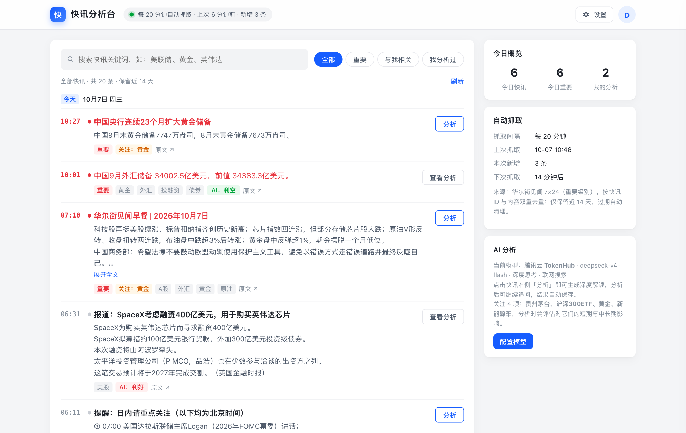
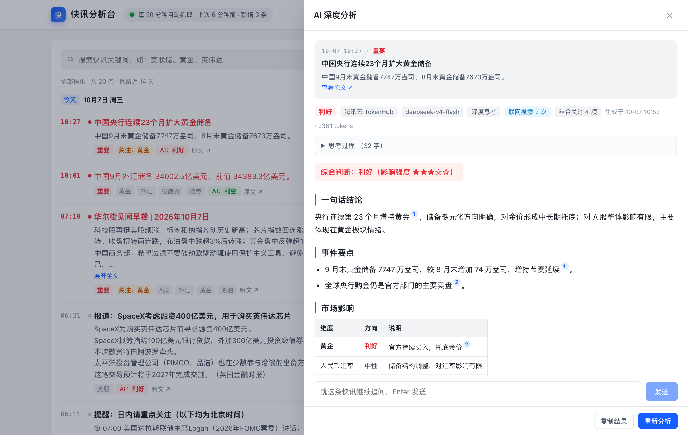
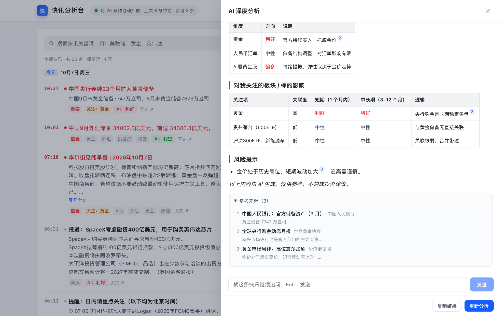
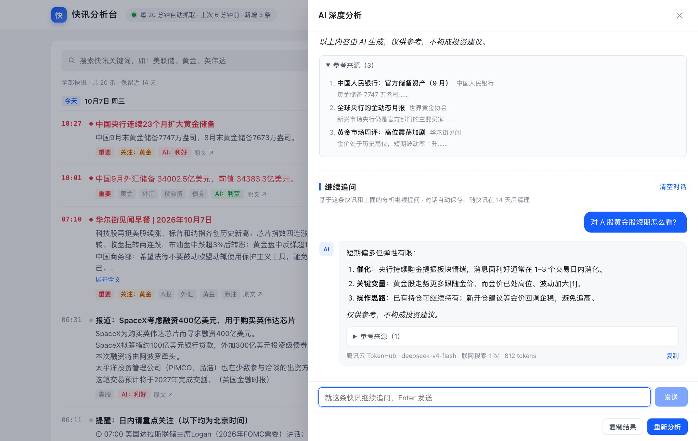
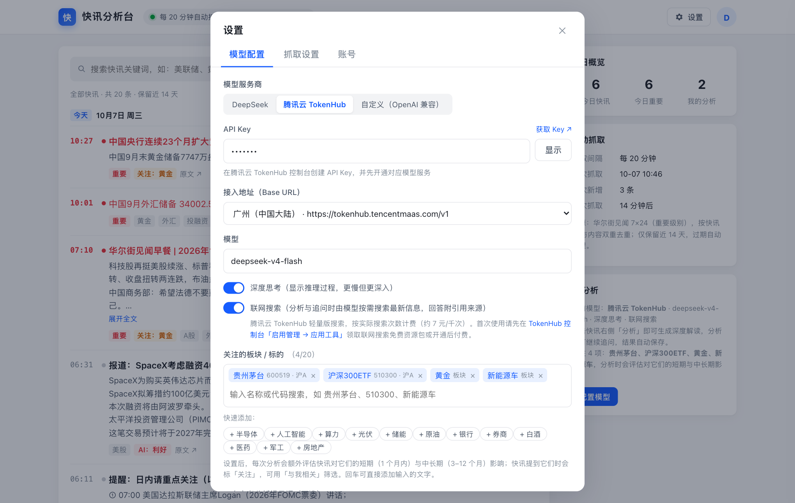

# 快讯分析台

定时抓取**华尔街见闻 7×24**、**财联社电报**和**金十数据**三个来源的快讯并去重入库，分 tab 展示。用户登录后，用自己的 DeepSeek 或腾讯云 TokenHub API Key 让大模型深度解读每条快讯，可以继续追问、联网搜索，还能结合自己关注的板块和标的，看快讯对它们的短期与中长期影响。

基于 WorkBuddy 云服务（数据库 + 登录）和「发布为应用」。**任何人都能用自己的 WorkBuddy 一句话部署出一模一样的站点**，见下方「部署」。



| 深度分析（引用来源） | 结合关注列表的影响评估 |
|---|---|
|  |  |
| **继续追问** | **模型配置 · 关注列表 · 联网搜索** |
|  |  |

<sub>截图为本地演示数据，分析内容为示例。</sub>

## ✨ 功能

| 模块 | 说明 |
|---|---|
| 快讯来源 | 华尔街见闻 7×24（全部快讯，编辑评级 2 级及以上标「重要」，约 300 条/天）；财联社电报（全部普通电报，加红电报标「重要」，约 400 条/天，付费栏目不收录）；金十数据 7×24（important 标「重要」，约 300 条/天，VIP 专享不收录）。来源可插拔，见 `lib/sources/` |
| 自动抓取 | 默认每 20 分钟一次，管理员可在线调整（1–1440 分钟）；同一来源内按快讯 ID + 内容哈希双重去重；漏抓时自动翻页补齐 |
| 数据保留 | 默认保留 14 天（管理员可调 1–14 天），数据库定时任务每小时清理，分析和追问随快讯一起删除 |
| 登录注册 | 手机号验证码、邮箱（密码 / 验证码 / 找回密码）；不登录看不到任何数据 |
| 快讯列表 | 「全部 / 华尔街见闻 / 财联社 / 金十」四个 tab（记住上次选择，其他 tab 显示未读数）；「全部」整合三来源并跨来源去重（存在至少 X 个连续相同的字判为重复，X 管理员可调，默认 5；保留最早发布的一条并标「N 家来源报道」）；按日期分组、重要快讯标红；财联社条目显示主题与相关个股；搜索；「重要 / 与我相关 / 我分析过」筛选；新快讯提醒 |
| 深度分析 | 每条快讯右侧「分析」，流式输出，可显示思考过程；首行给出「利好 / 利空 / 中性」结论（A 股习惯：利好红、利空绿）；结果按账号私有保存 |
| 继续追问 | 分析完成后多轮对话，上下文包含快讯、分析与历史对话；对话云端保存，换设备也能接着聊 |
| 关注列表 | 最多 20 个板块 / 标的（支持搜索 A 股、港股、美股、ETF、指数）；分析时额外评估短期（1 个月内）与中长期（3–12 个月）影响；列表里标出相关快讯 |
| 联网搜索 | TokenHub（广州）上的 deepseek-v4-flash / deepseek-v4-pro / hy3 可按需联网，回答带 [n] 引用角标和参考来源；未开通时自动降级为不联网 |
| 模型 | DeepSeek、腾讯云 TokenHub（按厂商分组预置 39 个语言模型：DeepSeek、混元、GLM、Kimi、MiniMax、Qwen、MiMo、Step）、任意 OpenAI 兼容接口；不在列表里的模型可以手动填写模型名称 |
| 安全 | API Key 存在用户自己的云端账号里，只有本人能读；服务端只转发、不记录；所有表启用行级安全（RLS） |

## 🚀 部署（用 WorkBuddy，约 10 分钟）

1. 在 WorkBuddy 里新建一个任务，把下面这段话发给它：

   > 请帮我部署 https://github.com/wsyscale/flash-news ：先把仓库克隆到当前工作目录，然后严格按仓库里 `DEPLOY.md` 第三部分「给 WorkBuddy 的执行步骤」完成部署：开通云服务、生成配置和密钥、按顺序执行 36 步建库、发布上线，最后运行上线检查。域名前缀用 `flash-news-<改成你想要的英文>`。不要修改业务代码。

2. 中途弹出「开通云服务」确认框时点确认。
3. 部署完成后：
   - 在应用的云服务面板里打开「手机号验证码登录」和「邮箱登录」；
   - 打开站点注册登录，马上到「设置 → 抓取设置」点「认领管理员」（只有第一个人能认领）；
   - 在「设置 → 模型配置」填 DeepSeek 或 TokenHub 的 API Key。

完整步骤、原理和常见问题见 [DEPLOY.md](DEPLOY.md)。

> 访问范围由账号决定：部分企业账号发布的应用是内网域名（如 `*.app-tencent.workbuddy.host`），只能在公司网络里打开。

## 🏗️ 架构

```
华尔街见闻 7×24 API ─┐
财联社电报 API ──────┤
金十数据 7×24 API ───┴─定时抓取─▶ Node 服务（server.js）
                                   │  去重、暂存、HMAC 签名、凭数据库收据确认入库
                                   │  /api/analyze /api/chat 转发到模型服务（流式）
                                   ▼
                          浏览器（public/，原生 ES Module）
                                   │  登录用户把签名批次写入数据库（ingest_signed 验签、回签收据）
                                   ▼
                     WorkBuddy 云服务：PostgreSQL + RLS + 登录
                     （news_digest 跨来源去重摘要；pg_cron 每小时清理过期快讯与摘要）
```

发布环境里的服务端访问不了云数据库，所以入库由已登录用户的浏览器代为完成，服务端签名、数据库验签，伪造的数据写不进去。没有用户访问时，抓取照常进行，数据会在下次有人打开页面时补进数据库。

## 📁 目录

```
server.js              HTTP 服务：静态页面、抓取调度、签名同步、模型转发
lib/                   抓取、调度、暂存、签名、模型接入、证券搜索
lib/sources/           快讯来源（wscn 华尔街见闻、cls 财联社电报、jin10 金十数据；新增来源加一个模块即可）
public/                前端页面（无构建步骤）
db/schema.sql          完整建库脚本（36 步，可重复执行；旧版数据库重跑一遍即可升级）
scripts/setup.mjs      部署辅助：生成密钥、写配置、取建库步骤、上线检查、打包
scripts/check-websearch.mjs  检测 TokenHub 账号能否联网搜索
config/app.example.json      配置模板（真实的 app.json / secret.json 部署时生成，不提交）
DEPLOY.md              部署说明
```

## 🛠️ 本地运行

需要先按 DEPLOY.md 完成云服务开通和建库，生成 `config/app.json` 与 `config/secret.json`。

```bash
npm install
node scripts/setup.mjs check           # 检查配置
PORT=3000 node server.js               # 启动；CRAWLER_DISABLED=1 可关闭定时抓取
node server.js --crawl-once            # 在能直连云数据库的环境抓取一次并直接入库
```

## ⚠️ 声明

- 快讯内容来自华尔街见闻、财联社、金十数据的公开网页接口，版权归原网站及作者所有。本项目仅供学习和研究，请勿用于商业转载；公开部署前请确认符合来源网站的使用条款。
- AI 生成的分析仅供参考，**不构成任何投资建议**。面向公众提供证券投资分析服务可能需要相关资质，请自行评估合规风险。
- 用户填写的 API Key 由用户自己保管，调用费用由各自的模型服务商账号承担。

## 📄 许可证

[MIT](LICENSE)
